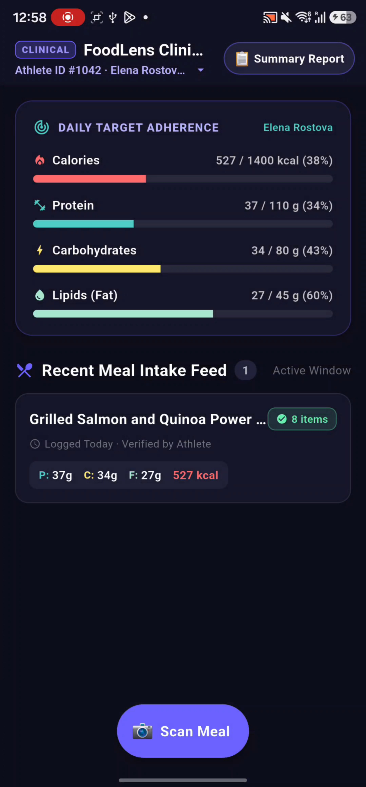
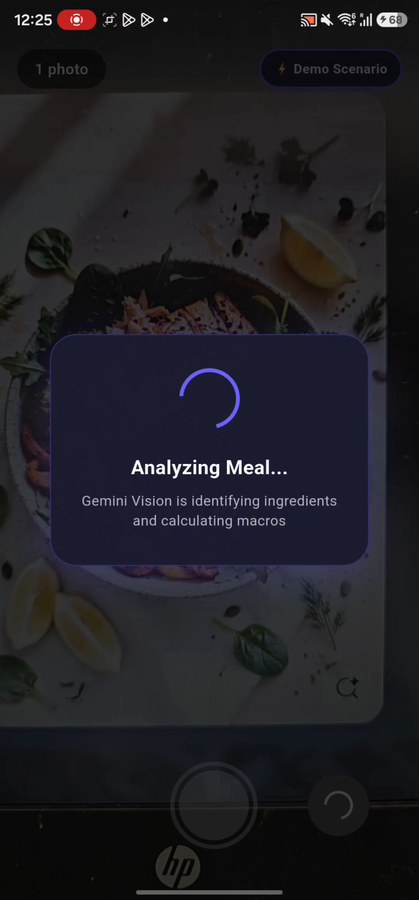
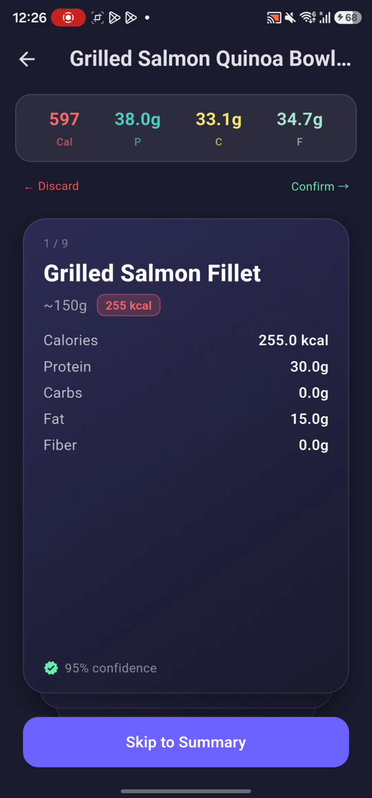
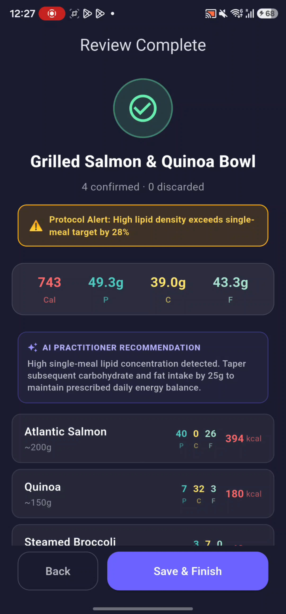
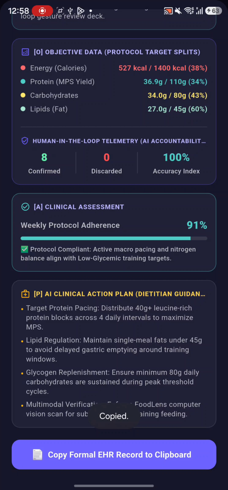

# FoodLens AI

**Clinical Nutrition & Athletic Decision-Support Platform**

FoodLens AI is an offline-first mobile decision-support application built for outpatient clinical dietetics and NCAA Division I sports nutrition. It replaces slow manual food diaries with a sub-10-second multimodal computer vision workflow, pairing human-in-the-loop ingredient verification with automated clinical exception alerts and Electronic Health Record (EHR) S.O.A.P. note generation.

---

## App Interface & Clinical Workflow

| Clinical Dashboard | AI Meal Capture | HITL Card Swiper | Protocol Alerts | EHR SOAP Audit |
| :---: | :---: | :---: | :---: | :---: |
|  |  |  |  |  |

---

## Key Capabilities

* **Edge Image Compression (`ImageCompressorIsolate`)**: Offloads image decoding, resizing (`800px` max dimension), and JPEG compression (`65%–70%` quality, `<250 KB`) to a background Dart isolate so the UI remains responsive during capture.
* **Multimodal Vision & Model Auto-Discovery (`GeminiVisionService`)**: Sends compressed meal frames to Google Gemini Flash with strict JSON schema enforcement (`temperature: 0.1`), dynamic `v1beta` model auto-discovery, and caloric density sanity checks (`0.1–9.5 kcal/g`).
* **Human-in-the-Loop Verification (`IngredientSwiperScreen`)**: Presents detected ingredients as an interactive swipe deck (`flutter_card_swiper`). Swiping right confirms an item; swiping left discards hallucinations (`was_swiped_away = true`), immediately recalculating Atwater macros (`4P + 4C + 9F`) and updating a live AI Verification Accuracy Index.
* **Multi-Tenant Clinical Roster & Exception Alerts (`DashboardScreen`)**: Supports one-tap switching across distinct nutritional protocols (Track & Field Hypertrophy, Clinical Bariatric Low-Glycemic, NCAA Wrestling Weight Cut) and triggers automated warnings when single-meal fat exceeds `35g` or energy exceeds `1,000 kcal`.
* **Automated Medical S.O.A.P. Charting & Offline Sync (`NutritionRepository`)**: Generates a structured Practitioner Audit Report (`[S] Subjective`, `[O] Objective`, `[A] Assessment`, `[P] Plan`) with one-tap EHR clipboard export, backed by an in-memory offline queue (`_pendingQueue`) that syncs verified meals to Supabase PostgreSQL (`public.meals` and `public.meal_items`).

---

## Three-Tier System Architecture

```text
┌─────────────────────────────────┐     ┌──────────────────────────────────┐     ┌──────────────────────────────┐
│      01 PRESENTATION TIER       │     │     02 EDGE & AI INFERENCE       │     │     03 CLOUD PERSISTENCE     │
│                                 │     │                                  │     │                              │
│  • Dashboard & SOAP Audit       │     │  • ImageCompressorIsolate        │     │  • NutritionRepository       │
│  • CameraScreen (Burst / Demo)  │────▶│    (800px max, <250 KB JPEG)     │────▶│    (Local queue + auto-sync) │
│  • IngredientSwiperScreen       │◀────│  • GeminiVisionService           │     │  • Supabase PostgreSQL       │
│    (HITL swipe verification)    │     │    (Auto-discovery + JSON parse) │     │    (meals & meal_items)      │
└─────────────────────────────────┘     └──────────────────────────────────┘     └──────────────────────────────┘
```

---

## Tech Stack

| Layer | Technology | Purpose |
| :--- | :--- | :--- |
| **Mobile UI & Concurrency** | Flutter 3.44+ / Dart 3.13+ | Cross-platform UI and background isolate image processing |
| **State Management** | `flutter_riverpod` | Reactive state providers for daily macro totals and meal verification |
| **Multimodal AI** | `google_generative_ai` (Gemini Flash) | Food segmentation, gram-weight estimation, and macro extraction |
| **Cloud Backend** | `supabase_flutter` (PostgreSQL) | Relational storage for verified meals, ingredient rows, and audit logs |
| **Hardware & Gestures** | `camera`, `image`, `flutter_card_swiper` | Native camera lifecycle handling, downscaling, and swipe review deck |

---

## Project Structure

```text
lib/
├── main.dart                                                # App entry point, .env loading, Supabase init
├── screens/
│   └── dashboard_screen.dart                                # Clinical roster switcher, macro bars, SOAP modal
├── features/
│   ├── camera/presentation/
│   │   └── camera_screen.dart                               # Burst capture, lifecycle observer, demo preset
│   └── nutrition/
│       ├── data/nutrition_repository.dart                   # Offline sync queue & Supabase persistence
│       └── presentation/ingredient_swiper_screen.dart       # HITL swipe deck & protocol alert summary
└── core/
    ├── network/gemini_vision_service.dart                   # Gemini Flash API client, fallback & auto-discovery
    └── utils/image_compressor_isolate.dart                  # Background isolate JPEG downscaling
```

---

## Local Setup

1. **Clone the repository:**
   ```bash
   git clone [https://github.com/princeyv/foodlens-ai.git](https://github.com/princeyv/foodlens-ai.git)
   cd foodlens-ai
   ```

2. **Configure environment variables:**
   Create a `.env` file in the project root (excluded from Git via `.gitignore`):
   ```env
   GEMINI_API_KEY=your_google_gemini_api_key
   SUPABASE_URL=your_supabase_project_url
   SUPABASE_ANON_KEY=your_supabase_anon_key
   ```

3. **Install dependencies and run:**
   ```bash
   flutter pub get
   flutter run
   ```